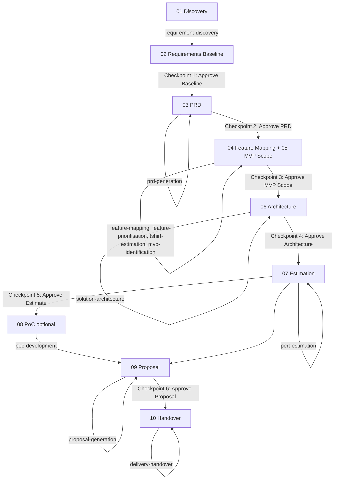

# Software Pre-Sales Framework

A reusable, AI-assisted software pre-sales framework built on **GitHub Copilot Custom Agents, Agent Skills, and
Prompt Files**. It takes a customer engagement from raw discovery notes through to a signed-off proposal and
delivery handover, with traceability, confirmed-vs-assumed labeling, and human approval checkpoints baked in at
every stage.

## 1. Purpose

Pre-sales work (requirements discovery, PRD writing, feature mapping, architecture, estimation, proposal writing)
is repetitive across customers but easy to get wrong — requirements get invented, priority gets confused with
complexity, and commercial figures get quoted without a defensible basis. This framework encodes the process as:

- **Agents** — specialist personas that own a stage of the pre-sales lifecycle.
- **Skills** — modular, reusable instructions for a specific technique (e.g. PERT estimation).
- **Prompt files** — one-shot invocations that wire an agent + skill + engagement folder together.
- **Templates** — the actual document/spreadsheet structures every stage must produce.
- **Engagements** — per-customer folders holding all generated artifacts, isolated from other customers.

All of it is governed by [.github/copilot-instructions.md](.github/copilot-instructions.md), the single source of
truth for cross-cutting rules (traceability, confirmed vs. assumed, estimation discipline, approval checkpoints).

## 2. Folder Structure

```
software-presales-framework/
├── .github/
│   ├── copilot-instructions.md     # Global rules — apply to every agent/skill/prompt
│   ├── agents/                     # 7 specialist agent definitions (*.agent.md)
│   ├── skills/                     # 11 Agent Skills, one folder per skill (SKILL.md)
│   └── prompts/                    # 6 reusable Copilot prompt files (*.prompt.md)
├── templates/                      # Reusable document/spreadsheet templates
└── engagements/
    └── <customer-name>/
        ├── 01-discovery/           # Raw customer material (notes, transcripts, RFPs)
        ├── 02-requirements/        # Requirements baseline
        ├── 03-prd/                # Product Requirements Document
        ├── 04-feature-mapping/    # Features / Epics / User Stories
        ├── 05-mvp/                 # MVP scope
        ├── 06-architecture/       # Solution architecture
        ├── 07-estimation/         # PERT-based effort estimate
        ├── 08-poc/                 # Proof-of-concept plan/results
        ├── 09-proposal/           # Customer-facing proposal
        └── 10-handover/           # Delivery handover package
```

`engagements/customer-001/` is a ready-to-copy scaffold — duplicate its folder structure for every new customer.

> **Why `.github/agents/`, `.github/skills/`, `.github/prompts/`?** These are the official VS Code / GitHub Copilot
> discovery locations for workspace-scoped custom agents (`.github/agents/*.agent.md`), Agent Skills
> (`.github/skills/<name>/SKILL.md`), and prompt files (`.github/prompts/*.prompt.md`). Placing them anywhere else
> (e.g. a top-level `agents/` folder) means Copilot will not auto-discover or load them. `templates/` and
> `engagements/` are plain reference/data folders, not Copilot customization primitives, so they remain at the
> repository root.

## 3. Agents (`.github/agents/`)

| Agent | Responsibility |
|---|---|
| [`presales-orchestrator`](.github/agents/presales-orchestrator.agent.md) | Coordinates the full workflow, delegates to specialists, enforces approval checkpoints. |
| [`business-analyst`](.github/agents/business-analyst.agent.md) | Extracts and structures requirements from raw discovery material. |
| [`product-manager`](.github/agents/product-manager.agent.md) | Writes the PRD, maps features/stories, scores priority, proposes MVP. |
| [`solution-architect`](.github/agents/solution-architect.agent.md) | Designs the technical architecture, scores technical complexity. |
| [`technical-estimator`](.github/agents/technical-estimator.agent.md) | Produces the PERT-based effort estimate. |
| [`poc-engineer`](.github/agents/poc-engineer.agent.md) | Scopes and documents proof-of-concept work to de-risk architecture assumptions. |
| [`proposal-writer`](.github/agents/proposal-writer.agent.md) | Assembles the customer-facing proposal and delivery handover package. |

Each agent file documents: responsibilities, skills used, required inputs, expected outputs, workflow steps,
validation rules, and human approval checkpoints.

## 4. Skills (`.github/skills/`)

| Skill | Used By | Technique |
|---|---|---|
| [`requirement-discovery`](.github/skills/requirement-discovery/SKILL.md) | Business Analyst | Atomic requirement extraction + Confirmed/Assumed/Open Question tagging |
| [`prd-generation`](.github/skills/prd-generation/SKILL.md) | Product Manager | Requirements → PRD |
| [`feature-mapping`](.github/skills/feature-mapping/SKILL.md) | Product Manager | PRD → Features/Epics/User Stories |
| [`feature-prioritisation`](.github/skills/feature-prioritisation/SKILL.md) | Product Manager | Business priority scoring (MoSCoW), independent of complexity |
| [`tshirt-estimation`](.github/skills/tshirt-estimation/SKILL.md) | Product Manager | Early-stage XS–XL sizing |
| [`mvp-identification`](.github/skills/mvp-identification/SKILL.md) | Product Manager | MVP scope selection with exclusion rationale |
| [`solution-architecture`](.github/skills/solution-architecture/SKILL.md) | Solution Architect | Component/NFR-driven architecture design |
| [`pert-estimation`](.github/skills/pert-estimation/SKILL.md) | Technical Estimator | PERT: `(O + 4M + P) / 6` |
| [`poc-development`](.github/skills/poc-development/SKILL.md) | PoC Engineer | PoC scoping with measurable success criteria |
| [`proposal-generation`](.github/skills/proposal-generation/SKILL.md) | Proposal Writer | Proposal assembly from approved artifacts |
| [`delivery-handover`](.github/skills/delivery-handover/SKILL.md) | Proposal Writer | Handover package for the delivery team |

Every `SKILL.md` follows the same structure: Purpose, When to Use, Required Input, Step-by-Step Execution, Business
Rules, Output Format, Quality Validation Checklist, Example Usage — so skills stay modular and reusable across
engagements.

## 5. Prompt Files (`.github/prompts/`)

| Prompt | Invokes |
|---|---|
| [`analyse-requirements.prompt.md`](.github/prompts/analyse-requirements.prompt.md) | `business-analyst` + `requirement-discovery` |
| [`generate-prd.prompt.md`](.github/prompts/generate-prd.prompt.md) | `product-manager` + `prd-generation` |
| [`generate-features.prompt.md`](.github/prompts/generate-features.prompt.md) | `product-manager` + `feature-mapping`/`feature-prioritisation`/`tshirt-estimation`/`mvp-identification` |
| [`generate-architecture.prompt.md`](.github/prompts/generate-architecture.prompt.md) | `solution-architect` + `solution-architecture` |
| [`estimate-project.prompt.md`](.github/prompts/estimate-project.prompt.md) | `technical-estimator` + `pert-estimation` |
| [`generate-proposal.prompt.md`](.github/prompts/generate-proposal.prompt.md) | `proposal-writer` + `proposal-generation` |

Each prompt file takes a `${input:customer}` variable identifying the engagement folder, checks that the required
upstream artifact is already human-approved, and stops at the relevant approval checkpoint rather than
auto-proceeding.

## 6. Templates (`templates/`)

| Template | Format | Notes |
|---|---|---|
| [`requirement-template.md`](templates/requirement-template.md) | Markdown | Requirement ID, source, status columns |
| [`prd-template.md`](templates/prd-template.md) | Markdown | Capability areas, NFRs, assumptions, open questions |
| [`feature-mapping-template.xlsx`](templates/feature-mapping-template.xlsx) | Excel | Dropdowns for Priority/T-Shirt Size/Complexity, example rows |
| [`architecture-template.md`](templates/architecture-template.md) | Markdown | Mermaid component diagram, NFR coverage table |
| [`estimation-template.xlsx`](templates/estimation-template.xlsx) | Excel | By Feature / By Role / Summary sheets, roll-up formulas |
| [`pert-template.xlsx`](templates/pert-template.xlsx) | Excel | PERT formula `=(O+4*M+P)/6`, std-dev, order-check column |
| [`proposal-template.md`](templates/proposal-template.md) | Markdown | Scope, solution overview, indicative commercial summary |

## 7. How to Invoke Agents

In GitHub Copilot Chat, select the relevant custom agent (e.g. `@presales-orchestrator` or
`business-analyst`/`product-manager`/etc., depending on your Copilot client's agent-selection UI) and describe the
engagement you're working on, e.g.:

> "Act as the presales-orchestrator for `engagements/acme-corp/`. What's the next stage?"

The orchestrator inspects which stage folders already have substantive content and delegates to the correct
specialist agent.

## 8. How to Use Prompt Files

Run a prompt file directly from the Copilot Chat prompt picker (or reference it with `/<prompt-name>` depending on
your client), supplying the `customer` input, e.g.:

> `/analyse-requirements customer=acme-corp`

Each prompt file states its required inputs, applies the relevant skill(s), writes output to the correct
`engagements/<customer>/<stage>/` folder, and stops at the next human approval checkpoint.

## 9. Starting a New Customer Engagement

1. Copy the folder structure of `engagements/customer-001/` to `engagements/<new-customer-name>/`.
2. Drop raw discovery material (notes, transcripts, RFPs) into `01-discovery/`.
3. Invoke `analyse-requirements.prompt.md` (or the `business-analyst` agent) with `customer=<new-customer-name>`.
4. Proceed stage by stage per the workflow below, approving at each checkpoint.

## 10. End-to-End Pre-Sales Workflow



Human approval checkpoints are mandatory gates — no agent or skill proceeds past one without explicit sign-off
(see [.github/copilot-instructions.md §9](.github/copilot-instructions.md)).

## 11. Adding New Agents and Skills

- **New skill:** create `.github/skills/<skill-name>/SKILL.md` following the structure used by existing skills
  (Purpose, When to Use, Required Input, Step-by-Step Execution, Business Rules, Output Format, Quality Validation
  Checklist, Example Usage). Reference it from the agent(s) that should use it.
- **New agent:** create `.github/agents/<agent-name>.agent.md` with YAML frontmatter (`name`, `description`,
  `tools`), followed by Role, Responsibilities, Skills Used, Input Documents, Expected Output, Workflow
  Instructions, Validation Rules, and Human Approval Checkpoints. Add it to the `presales-orchestrator`'s
  delegation table if it participates in the main workflow.
- **New prompt file:** create `.github/prompts/<prompt-name>.prompt.md` with `agent: agent` frontmatter,
  referencing the agent/skill(s) to apply and the expected input/output paths.
- Keep all new artifacts consistent with the global rules in
  [.github/copilot-instructions.md](.github/copilot-instructions.md) — do not duplicate those rules inline; link to
  them instead.

## 12. Implementation Notes

- All customer data must remain under its own `engagements/<customer>/` folder — never copied into `skills/` or
  `templates/` (see global instructions §8).
- Every generated document must distinguish `Confirmed`, `Assumed`, and `Open Question` content.
- Costs and timelines are always **indicative** until the relevant human approval checkpoint has been passed.
