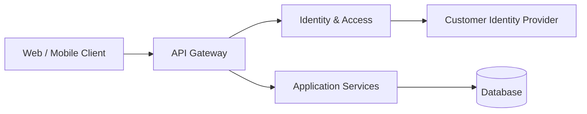

# Solution Architecture — `<Customer Name>`

> Instructions: Every component must map to at least one MVP feature; every NFR must have an explicit mechanism.
> See `skills/solution-architecture/SKILL.md`.

## 1. Architecture Overview

## 2. Component Responsibilities

| Component | Responsibility | Related Feature ID(s) |
|---|---|---|
| Identity & Access | Handles authentication/authorization, SSO integration | FEAT-003 |
| Application Services | Core business logic | FEAT-001, FEAT-002 |

## 3. Integration Points

| System | Direction | Protocol | Notes |
|---|---|---|---|
| Customer Identity Provider | Inbound (auth) | OIDC/SAML | Confirm tenant configuration — Open Question |

## 4. Non-Functional Requirements Coverage

| Requirement ID | NFR | Architectural Mechanism |
|---|---|---|
| REQ-002 | Sustain 500 concurrent users | Horizontal autoscaling of Application Services tier |

## 5. Deployment Topology

_(Describe environments — dev/test/staging/prod — hosting model, and scaling approach.)_

## 6. Risks & Assumptions

| Risk/Assumption | Impact | Status |
|---|---|---|
| Customer's IdP tenant configuration unknown | May delay SSO integration | Open Question |

## 7. Open Questions

- _(List unresolved technical questions here.)_
